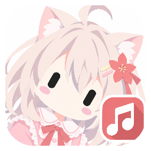

# 🎵 Nonet Music Player

> [!WARNING]
> 本项目由 AI 完成，尚未经过独立人工代码 review。已在 Windows 和 Android 15 模拟器验证；macOS 和 Linux 仅生成交叉构建产物，未做对应系统实机测试。当前为预发布版本，使用前请备份数据，参与开发前请审查相关代码。

<p align="center"></p>
<p align="center"><b>Nonet · 桌面、终端与 Android，用各自合适的方式听音乐。</b></p>
<p align="center">
  <a href="LICENSE"></a>
  
  
  
  
</p>
<p align="center">
  <a href="https://github.com/hhwfsl/NonetMusicPlayer/releases">下载发行包</a> ·
  <a href="#-构建前提">从源码构建</a> ·
  <a href="docs/UserManual.zh-CN.md">桌面手册</a> ·
  <a href="src/NonetMusicPlayer.Android/docs/USER_GUIDE.md">Android 手册</a> ·
  <a href="CHANGELOG.md">变更日志</a>
</p>

让编译器忙一点，让耳朵轻松一点。本文介绍技术栈、源码结构和构建方式。

| 产品 | 当前版本 | 发行说明 |
| --- | --- | --- |
| 桌面 | [0.4.0-beta.40](https://github.com/hhwfsl/NonetMusicPlayer/releases/tag/v0.4.0-beta.40) | Windows x64/x86/ARM64：ZIP + installer；Linux x64/ARM64、macOS x64：ZIP |
| CLI | [0.4.0-beta.32](https://github.com/hhwfsl/NonetMusicPlayer/releases/tag/v0.4.0-beta.32) | Windows、Linux、macOS x64 |
| Android | [0.3.0-beta.9](https://github.com/hhwfsl/NonetMusicPlayer/releases/tag/android-v0.3.0-beta.9) | API 28+；通用 APK；沿用既有测试签名 |

本仓库包含桌面、CLI、共享核心、Android、插件 SDK、打包器和测试。插件模板独立维护在 [NonetMusicPlayerPlugin](https://github.com/hhwfsl/NonetMusicPlayerPlugin)。

## 🧰 技术栈

| 用途 | 技术 / 固定版本 |
| --- | --- |
| 构建与语言 | .NET SDK 10.0.401，C#，目标 net10.0 |
| 桌面界面 | Avalonia / Desktop / Fluent / Inter 12.1.1 |
| 崩溃观察器 | C++17，Zig 0.15.2 交叉编译；独立本地进程 |
| MVVM | CommunityToolkit.Mvvm 8.4.2 |
| 音频 | SoundFlow 1.4.1，SoundFlow.Codecs.FFMpeg 1.4.0 |
| 媒体标签 | TagLibSharp 2.3.0 |
| 桌面持久化 | SQLite，Microsoft.Data.Sqlite 10.0.12 |
| CLI 与共用 JSON | System.Text.Json，持久化模型使用 Source Generation |
| 插件开发 SDK | NonetMusicPlayer.PluginSdk 4.16.0，Contract v1/v2、页面 Schema v1/v2 |
| Android 构建 | Kotlin 2.1.20，AGP 8.10.1，Gradle Wrapper 8.12，JDK 17–21 |
| Android UI | Compose BOM 2025.05.01；自有 Foundation 控件，不使用 Material3 或 WebView |
| Android 音频 / 网络 | Media3 1.6.1，OkHttp 4.12.0，Coil 2.7.0 |
| Android 数据 / SDK | 系统 SQLite；compile / target / min SDK 为 36 / 36 / 28 |

CLI 不引用 Avalonia，通过系统终端运行。插件 SDK 无图形、音频或外部 NuGet 依赖。实际依赖以各项目的 `.csproj` 为准；第三方许可见 [docs/licenses](docs/licenses)。

桌面发行构建还需要 C/C++ 编译器；使用 `NONET_ZIG` 指定 Zig 路径。崩溃观察器的构建、平台行为与测试见 [native/NonetCrashHandler](native/NonetCrashHandler/README.md)。

## 📜 许可证

项目源码及插件基础工程采用 [GNU GPL v3.0](LICENSE)（SPDX：GPL-3.0-only）。第三方依赖保留其原有许可证，见 `docs/licenses`；发行包随附完整项目许可及第三方许可。

## 🔨 构建前提

- 安装 [.NET 10 SDK](https://dotnet.microsoft.com/download/dotnet/10.0)。`global.json` 固定 10.0.401 并允许同一特性带的后续补丁；SDK 8/9 不能构建 net10.0。
- 安装 Git；首次还原需要访问 nuget.org。无需复制开发机器的 NuGet 缓存。
- 发布脚本使用 PowerShell；建议 PowerShell 7。普通构建和运行直接使用 dotnet，不需要 PowerShell。
- Windows 桌面提供 x64、x86 与 ARM64，最低 Windows 10 22H2，不支持 Windows 7 或 Windows ARM32。Linux 提供 x64、ARM64（glibc），macOS 保持 x64；各包只携带相应架构的原生依赖。ARM64 与 Linux/macOS 尚未经对应设备实机验证，不能将交叉构建成功视为真机通过。原生插件也需匹配宿主进程架构。

```text
git clone https://github.com/hhwfsl/NonetMusicPlayer.git
cd NonetMusicPlayer
dotnet --version
dotnet restore NonetMusicPlayer.slnx --configfile NuGet.Config
dotnet build NonetMusicPlayer.slnx -c Release --no-restore
```

## ▶️ 从源码启动

桌面端：

```text
dotnet run --project src/NonetMusicPlayer.Desktop -c Release
```

独立 CLI（无桌面依赖）：

```text
dotnet run --project src/NonetMusicPlayerCli -c Release -- help
dotnet run --project src/NonetMusicPlayerCli -c Release
```

两者的数据默认保存在各自程序目录的 `Data` 中；不要让桌面版与 CLI 共用数据目录。桌面隔离测试可使用 `NONET_DATA_DIR` 环境变量。开发运行目录需要可写权限。

## 📱 构建 Android

安装 JDK 17–21、Android SDK Platform 36 和 Build Tools 35.0.0。配置 `ANDROID_HOME`，或在 Android 目录创建本地 `local.properties`：`sdk.dir=/path/to/android/sdk`。Android Studio 可直接打开该目录，也可完全使用命令行。

```sh
cd src/NonetMusicPlayer.Android

# Linux / macOS；Windows 将 ./gradlew 换成 .\gradlew.bat
./gradlew :app:assembleDebug
./gradlew :app:testDebugUnitTest
./gradlew :app:connectedDebugAndroidTest
./gradlew :app:assembleRelease
```

Debug APK 位于 `app/build/outputs/apk/debug/app-debug.apk`，裁剪后的 Release APK 位于 `app/build/outputs/apk/release/app-release.apk`。仪器测试需要设备或模拟器，详见 [Android 测试](src/NonetMusicPlayer.Android/docs/TESTING.md)。Android 不要求安装 .NET。

当前预发布使用调试签名，不适合直接作为商店正式发行。使用 `-PnonetSigningStore=/path/to/original/debug.keystore` 可指定测试证书；签名私钥应安全保管。自行构建的签名若不同，不能覆盖安装官方 APK，应用内更新同样拒绝不同签名。更换签名前请先导出数据，不要直接卸载。

本地发布可运行 `pwsh -File scripts/publish.ps1 -SigningStore /path/to/original/debug.keystore`，APK 输出到主项目 `publish/android`，复制校验成功后只保留最新 APK。GitHub 使用独立 `android-v<版本>` 标签和 `Nonet-<版本>.apk`，规则见 [Android 更新协议](src/NonetMusicPlayer.Android/docs/UPDATES.md)。

## 🚚 自包含发布

在仓库根目录执行：

```text
pwsh -File scripts/publish-desktop.ps1 -CleanOnly -SkipInstaller
pwsh -File scripts/publish-cli.ps1 -CleanOnly
```

桌面默认生成六种 RID；仅构建新增目标可在 PowerShell 中执行：

```powershell
./scripts/publish-desktop.ps1 -CleanOnly -Rids win-x86,win-arm64,linux-arm64
./scripts/verify-clean-desktop.ps1 -Version 0.4.0-beta.36
```

Windows 默认同步各架构安装器。`publish/desktop/windows_installer` 每个架构仅保留最新成功版本；纯净 ZIP 位于 `publish/desktop/archives`。`-CleanOnly` 不覆盖已有便携程序及用户数据。

桌面版从新的 `artifacts/publish-stage-*` 构建，纯净 ZIP 输出到 `publish/desktop/archives`，不会读取或替换已有 `publish/desktop/windows`、`macos`、`linux`。CLI 的 `-CleanOnly` 输出新的 `artifacts/cli-stage-*`，不修改既有 CLI 发布目录。两者均自带 .NET 运行时，保留必要原生音频库、元数据库与许可文件，不附带个人数据、构建缓存或调试符号。

桌面更新资产的文件名固定为：

```text
NonetMusicPlayer.Desktop-0.4.0-beta.36-win-x64.zip
NonetMusicPlayer.Desktop-0.4.0-beta.36-win-x86.zip
NonetMusicPlayer.Desktop-0.4.0-beta.36-win-arm64.zip
NonetMusicPlayer.Desktop-0.4.0-beta.36-osx-x64.zip
NonetMusicPlayer.Desktop-0.4.0-beta.36-linux-x64.zip
NonetMusicPlayer.Desktop-0.4.0-beta.36-linux-arm64.zip
```

macOS ZIP 从 `Contents/` 开始组织，解压到 `Nonet.app/` 内；Linux/macOS 的 ZIP 保存可执行权限。未进行代码签名或 macOS 公证。更新清单与校验规则见 [UPDATES.md](docs/UPDATES.md)。

不带 `-CleanOnly` 的发布脚本会更新对应发布目录，并保留旧包和便携数据；已在使用的软件请优先采用纯净构建模式。普通 Windows 发布会同步构建安装器，不能使用 `-SkipInstaller`。安装器另需 Inno Setup 6，也可通过 `scripts/build-windows-installer.ps1` 单独构建；`windows_installer` 目录只保留最新成功版本。上述 `-CleanOnly -SkipInstaller` 命令仅构建 ZIP，不更新便携目录或安装器；移除 `-SkipInstaller` 则会同时从纯净暂存包构建 Windows 安装器。

## 🗂️ 项目组织

桌面、CLI、Android 与共享代码位于同一仓库；Android 是普通源码目录，不是子模块。`publish` 存放发行产物，`artifacts` 存放构建暂存和测试结果。

```text
src/NonetMusicPlayer.Desktop/           Avalonia 桌面宿主
src/NonetMusicPlayerCli/                独立终端 / TUI 宿主
src/NonetMusicPlayer.Core/              播放、命令、插件、歌词等共享逻辑
src/NonetMusicPlayer.PluginSdk/         独立插件验证及打包 SDK
src/NonetMusicPlayer.Android/           Kotlin / Compose / Media3 原生应用
tests/                                Core、桌面、插件、更新回归夹具
tools/NonetMusicPlayer.PluginPackager/  主项目维护的插件打包与验证入口
scripts/                              发布、校验和插件依赖检查脚本
docs/                                 开发文档、使用手册、第三方许可
assets/icons/                         图标源文件及跨平台表示
```

插件模板是独立仓库 [NonetMusicPlayerPlugin](https://github.com/hhwfsl/NonetMusicPlayerPlugin)，可克隆到同级目录 `../NonetMusicPlayerPlugin`。插件通过 `ProjectReference` 引用本仓库 `src/NonetMusicPlayer.PluginSdk`，打包使用 `tools/NonetMusicPlayer.PluginPackager`，调试运行桌面宿主。构建模板需要本仓库源码，模板不包含 SDK 副本。

插件以独立项目维护，由各项目的构建脚本生成 `.impp` 包。主解决方案和默认测试不依赖具体插件项目；开发步骤见[插件开发文档](docs/PLUGIN_DEVELOPMENT.md)。

## ✅ 验证与参与开发

```text
dotnet run --project tests/NonetMusicPlayer.CoreChecks -c Release -- artifacts/core-checks
dotnet run --project tests/NonetMusicPlayer.UiChecks.Desktop -c Release -- artifacts/ui-checks --desktop-revision-only
dotnet run --project tests/NonetMusicPlayer.UiChecks.Desktop -c Release -- artifacts/nonet-checks --nonet-release-only
dotnet run --project tests/NonetMusicPlayer.PluginUiChecks.Desktop -c Release -- artifacts/plugin-checks
dotnet run --project tools/NonetMusicPlayer.PluginPackager -c Release -- help
```

UI 夹具使用 Avalonia.Headless 与隔离测试数据，不等同于跨平台实际交互、音频设备及安装验证。系统相关测试须在对应平台继续执行。

各版本的验证范围与平台限制见 [RELEASE_VALIDATION.md](docs/RELEASE_VALIDATION.md) 和 [Android 测试记录](src/NonetMusicPlayer.Android/docs/TESTING.md)。提交前请运行受影响模块的构建、测试及 `git diff --check`，同步变更日志，并注明测试环境和未验证的平台。

构建、变更和接口资料：[CHANGELOG](CHANGELOG.md)、[CLI 构建与使用](src/NonetMusicPlayerCli/README.md)、[插件开发与依赖](docs/PLUGIN_DEVELOPMENT.md)、[插件 Contract](docs/PLUGIN_DEVELOPMENT.md)、[存储](docs/STORAGE.md)、[本地化](docs/LOCALIZATION.md)。

插件开发使用主项目的 SDK 4.16.0（程序集兼容基线为 4.0.0.0），并直接引用源码；通用扩展接口见 [EXTENSIONS](docs/EXTENSIONS.md)、[非核心扩展参考](docs/UNIVERSAL_EXTENSIONS.md) 和 [风格与动画](docs/STYLE_EXTENSIONS.md)，旧插件兼容策略见 [PLUGIN_DEVELOPMENT](docs/PLUGIN_DEVELOPMENT.md)。Android 不提供插件或终端。

背景仅支持静态图片，不再需要独立视频解码器。音乐解码所需的 SoundFlow / FFmpeg 原生库仍保持独立、可替换，并保留许可。Arch Linux 与 niri 的启动方式见 [Linux 运行指南](docs/LINUX.md)。
